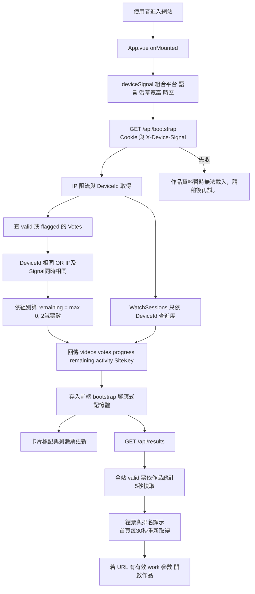
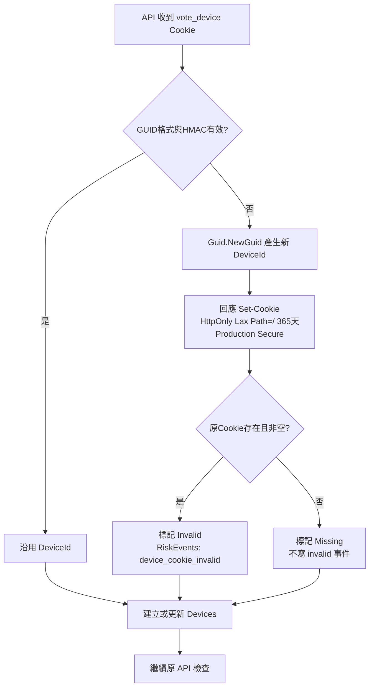
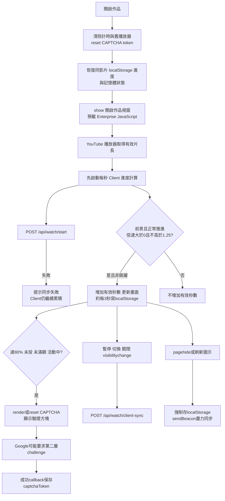
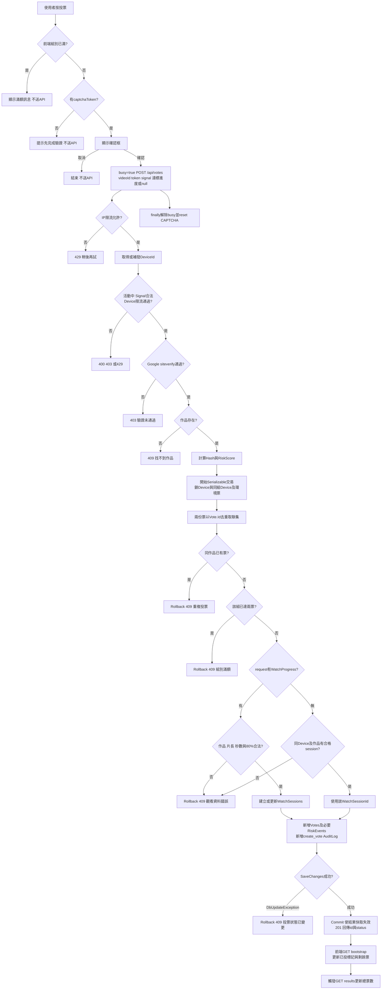
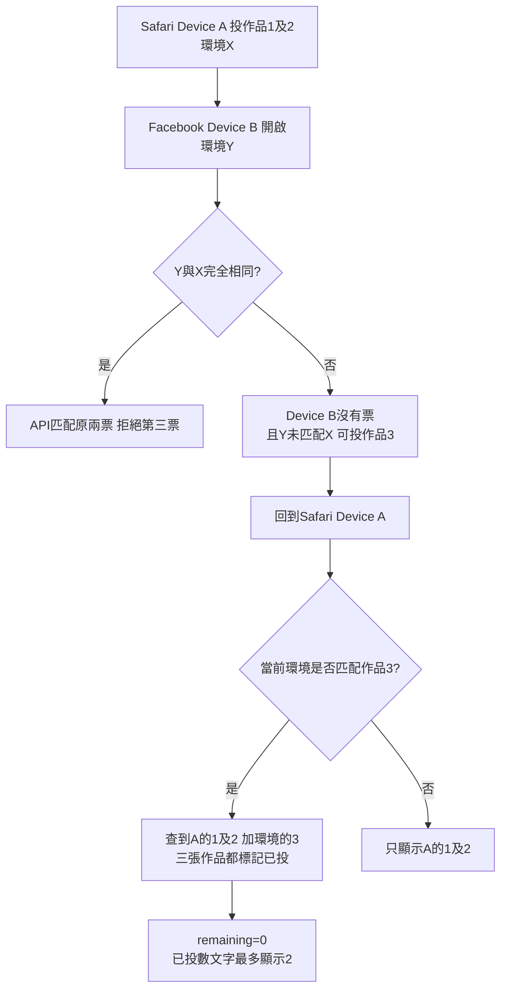
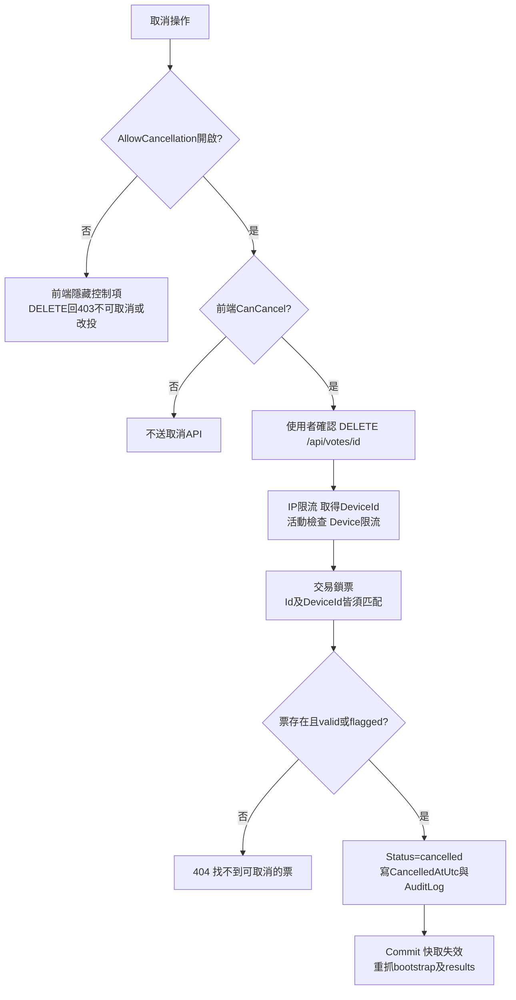

# 投票顯示、限制與網站資料流：程式碼索引及流程圖

更新：2026-10-15。依目前工作目錄程式碼整理；本文件描述現況，不代表已採用先前討論的 DeviceId-only 方案。適用連接 ASP.NET API 的網站，展示模式另見末節。

## 1. 先釐清目前規則

- 個人投票狀態不是只認 DeviceId：使用「目前 DeviceId 的票」或「目前 IP Hash 與 DeviceSignal Hash 同時匹配的票」聯集。
- 每組最多兩票、同作品不可重複，均在後端再檢查上述聯集。
- **沒有單一 IP 終身／活動期間只能投兩票的規則。** IP 單獨用於請求限流、風險計算；環境票數限制需要 IP 與 DeviceSignal 都匹配。
- `valid`、`flagged` 都占用配額；公開結果只統計 `valid`。
- 目前新票即使 RiskScore 很高也會是 `valid`，沒有自動以 60 分為門檻改成 `flagged`。
- 觀看資格主要接受 Client 回報；不能把 80% 進度當成可靠的防機器人證明。
- 本文件中的資料庫規則依 EF 設定與查詢碼描述，未連線稽核正式資料庫或核對正式部署版本。

## 2. 所有相關程式碼入口

路徑相對於 repository 根目錄；函式名可用 `rg -n` 定位，避免行號隨改版失效。

| 檔案 | 函式／欄位 | 作用 |
|---|---|---|
| `src/greencare-web/src/App.vue` | `onMounted`、`updateBootstrap` | 初次載入個人狀態、作品、總票數；接收投票後的新狀態 |
| 同上 | `remaining`、`voteFor`、`cardStatus` | 剩餘票、卡片已投／待確認／可投標記 |
| 同上 | `resultFor`、`refreshResults` | 卡片總票數、排名；每 30 秒更新結果 |
| `src/greencare-web/src/deviceContext.ts` | `deviceSignal`、`loadBootstrap` | 組合裝置訊號，透過 Header 傳給 bootstrap |
| `src/greencare-web/src/api.ts` | `api` | fetch、JSON、HTTP 非成功轉 Error；同源 Cookie 由瀏覽器自動附帶 |
| `src/greencare-web/src/types.ts` | `Bootstrap`、`Vote` | API 資料型別 |
| `src/greencare-web/src/VotingDialogs.vue` | `currentVote`、`groupVotes`、`groupFull` | 彈窗已投狀態、每組額度 |
| 同上 | `qualified`、`showCaptcha`、`canVote`、`voteButtonText` | 80% 門檻、驗證顯示與投票按鈕狀態 |
| 同上 | `restoreClientProgress`、`saveClientProgress`、`updateDisplayedProgress` | 記憶體／localStorage 觀看紀錄、畫面進度 |
| 同上 | `onPlayerReady`、`pollProgress`、`syncClientProgress` | 播放器初始化、每秒累積、同步後端 |
| 同上 | `open`、`navigate`、`close`、`visibilityChanged`、`pageHiding` | 開關作品、切換、隱藏頁面與離頁同步 |
| 同上 | `loadCaptchaScript`、`setupCaptcha`、`resetCaptcha`、`reloadCaptcha` | Google Enterprise JS、方塊渲染、token 清除、整頁刷新 |
| 同上 | `submitVote`、`askConfirmation`、`reload` | 前端防呆、確認框、POST、重抓 bootstrap |
| 同上 | `cancelVote` | 取消票；受功能開關與 CanCancel 限制 |
| `src/greencare-web/src/ResultsPage.vue` | 結果頁載入與作品連結 | 全站排名頁；不是目前使用者票額來源 |
| `src/greencare-web/public/styles.css` | `.video-card.voted`、`.card-state`、`.vote-button` | 已投標記與按鈕外觀 |
| 同上 | `.watch-dialog`、`.watch-backdrop`、`.captcha-*` | non-modal 彈窗及驗證 RWD |
| `src/GreenCare.Api/Program.cs` | middleware、MapGreenCare*Api | ForwardedHeaders → 例外／安全標頭 → 限流 → API |
| `src/GreenCare.Api/Features/PublicApiEndpoints.cs` | `BootstrapAsync` | 個人票、剩餘票、觀看進度、作品、活動狀態與公開 Site Key |
| 同上 | `StartWatchAsync`、`SyncClientProgressAsync`、`UpdateProgressAsync` | 建立觀看、Client 同步、舊式進度 API |
| `src/GreenCare.Api/Infrastructure/DeviceCookieService.cs` | `GetOrCreate` | 有效 Cookie 沿用；遺失／無效重新產生 GUID |
| `src/GreenCare.Api/Infrastructure/DeviceTokenService.cs` | `Create`、`TryRead` | DeviceId 與 HMAC 簽章驗證 |
| `src/GreenCare.Api/Features/Devices/DeviceIdentityService.cs` | `GetOrCreateDetailedAsync` | Devices 建立／LastSeen；無效 Cookie 寫入 RiskEvents |
| `src/GreenCare.Api/Features/Voting/VoteEnvironmentService.cs` | `Create` | IP、DeviceSignal 各自做 HMAC |
| `src/GreenCare.Api/Features/Voting/VotingEndpoints.cs` | `CreateAsync` | 正式投票檢查、鎖定、入庫、快取失效 |
| 同上 | `LockDeviceAsync`、`LockDeviceActiveVotesAsync`、`LockEnvironmentActiveVotesAsync` | 並行保護、DeviceId 與環境票查詢 |
| 同上 | `FindQualifiedWatchAsync`、`BuildVote`、`AddRiskEventIfNeeded` | 觀看資格、Vote 欄位、風險事件 |
| 同上 | `CancelAsync` | 功能開關、票的所有權、取消交易 |
| `src/GreenCare.Api/Features/Voting/VoteLimitValidator.cs` | `Validate` | 同作品重複與同組兩票檢查 |
| `src/GreenCare.Api/Features/Voting/CaptchaVerifier.cs` | `VerifyAsync` | Google siteverify；成功與 hostname 驗證 |
| `src/GreenCare.Api/Features/Voting/VoteRiskService.cs` | `EvaluateAsync`、`Calculate`、`Status` | 風險分數與票狀態 |
| `src/GreenCare.Api/Features/Voting/VoteDtos.cs` | CreateVoteRequest | videoId、recaptchaToken、deviceSignal、watchProgress |
| `src/GreenCare.Api/Features/Watching/ClientWatchProgressWriter.cs` | `ValidateFields`、`ValidateQualified`、`WriteAsync` | Client 欄位範圍、作品一致、80%、建立／更新 WatchSessions |
| `src/GreenCare.Api/Features/Watching/WatchProgressEvaluator.cs` | 進度判定 | 舊式 `/watch/progress` 的 server 計算 |
| `src/GreenCare.Api/Infrastructure/BackendInfrastructureExtensions.cs` | `AddIpPolicy`、服務註冊 | IP 限流、代理設定、CAPTCHA HTTP timeout |
| `src/GreenCare.Api/Infrastructure/RequestWindowLimiter.cs` | `Allow` | Device／Session 的 60 秒滑動視窗 |
| `src/GreenCare.Api/Infrastructure/ActivityService.cs` | `GetStatus` | 伺服器活動期間判斷 |
| `src/GreenCare.Api/Infrastructure/ApiExceptionMiddleware.cs` | `InvokeAsync` | 未處理例外轉通用 500 |
| `src/GreenCare.Api/Features/Results/ResultsEndpoints.cs` | `GetResultsAsync` | 只統計 valid 的各作品總票 |
| `src/GreenCare.Api/Features/Results/ResultsCache.cs` | `GetOrCreateAsync`、`Invalidate` | 5 秒結果快取，投票／取消後失效 |
| `src/GreenCare.Api/Data/Configurations/VoteConfiguration.cs` | 唯一索引、外鍵、check constraints | DB 最後一道資料一致性保護 |
| `src/GreenCare.Api/Data/Entities/Vote.cs`、`VoteValues.cs` | Vote 欄位與狀態常數 | DeviceId、VideoId、WatchSessionId、Hash、RiskScore、Status |

設定入口：`ActivityOptions.cs`、`CaptchaOptions.cs`、`SecurityOptions.cs`、`ForwardedHeadersSettings.cs`，及環境設定中的 `Activity`、`Captcha`、`Security`、`Voting:AllowCancellation`、`ForwardedHeaders`。勿將密碼或 SecretKey 複製進文件。

## 3. 整體進站與資料取得



bootstrap 成功後沒有個人票的定時輪詢；首頁 30 秒 timer 只更新 `/api/results`。別的分頁剛投票時，此頁個人票狀態可能仍舊，直到重新載入或本頁投票／取消後 reload。

## 4. DeviceId 與 Cookie 流程



DeviceId 是隨機 GUID，與裝置指紋無關。Cookie 為 `GUID.HMAC`；目前 token 本身沒有額外時間到期欄位，365 天是 Cookie MaxAge。Devices LastSeen 更新有程序內 5 分鐘節流。

Cookie 無效會重新發放身分，不會單因 Cookie 無效而拒絕投票；CAPTCHA、配額、進度等檢查仍須通過。Cookie 不存在也不會自動找回原 DeviceId。

## 5. 畫面如何標記與計算票數：關鍵程式摘錄

來源：`PublicApiEndpoints.BootstrapAsync`：

```csharp
votesQuery = votesQuery.Where(x =>
    x.DeviceId == deviceId ||
    (x.IpHash == environment.IpHash &&
     x.DeviceSignalHash == environment.DeviceSignalHash));
```

前置條件僅取 `valid`、`flagged`；若沒有 SignalHash，退回只查 DeviceId。

來源：`App.vue`：

```ts
const remaining = computed(() => Math.max(0, bootstrap.value?.remaining[category.value] ?? 2))
const voteFor = (id:number) => bootstrap.value?.votes.find(v => v.videoId === id)
function cardStatus(id:number) {
  const vote=voteFor(id)
  if(vote)return vote.status==='flagged'?'待確認':'已投票'
  const ratio=bootstrap.value?.progress.find(p=>p.videoId===id)?.ratio??0
  return ratio>=.8?'可投票':ratio>0?`已觀看 ${Math.floor(ratio*100)}%`:'開始觀看'
}
```

卡片 `:class="{voted:voteFor(video.id)}"` 加上已投樣式。上方顯示 `已投 {{2-remaining}} 票 / 尚餘 {{remaining}} 票`，上限 2 在前後端都有常數，調整規格時須一起檢查。

| 畫面 | 資料來源 | 判定 |
|---|---|---|
| 卡片已投票 | bootstrap.votes | 相同 videoId 且 valid |
| 卡片待確認 | bootstrap.votes | 相同 videoId 且 flagged |
| 卡片可投票 | bootstrap.progress | 無票且 ratio >= 0.8；此字樣未完整檢查活動或組別滿額 |
| 卡片已觀看 | bootstrap.progress | 無票且 0 < ratio < 0.8 |
| 尚餘票 | bootstrap.remaining | 後端聯集票數按組別扣除，最低 0 |
| 已投票數 | 2 - remaining | 聯集超過 2 時仍顯示 2，不代表只查到兩張票 |
| 作品總票數 | results.groups | 全站 valid 統計，與個人標記不同 |

彈窗 `canVote`：非 busy、未投此作品、組別未滿兩票、有 youtubeId、已達 80%、活動 active。**canVote 不包含 captchaToken**，所以按鈕可點時若尚未勾選，submitVote 會顯示「請先完成『我不是機器人』驗證。」（程式實際使用中文雙引號）。

## 6. 觀看、驗證與同步



localStorage key 是 `greencare-client-watch-v1`，以 VideoId 儲存並核對 youtubeId，並非以 DeviceId 分區。寫入失敗仍保留記憶體；重新整理後記憶體消失。倒轉當下不累積，但往回重播可以繼續累積有效秒數，不做播放區段去重。快轉跳躍不計有效秒數。

`/watch/start` 會找最近 30 分鐘同 DeviceId、作品、近似片長的 session，否則新建；返回 session token。目前前端每秒走 Client 計算，沒有每秒呼叫舊 `/watch/progress`。

同步回應只用較大 ratio 合併，不降低進度。關閉／離頁同步不保證送達；投票時可以直接附上達標進度補建 WatchSessions。

CAPTCHA 逾期清 token；載入錯誤顯示提示。刷新圖示會先保存進度，嘗試 beacon，約 300ms 後整頁 reload。作品視窗使用 `show()` 和自製遮罩，避免 `showModal()` top layer 阻擋 Google 第二層 iframe。切換作品會 reset 現有 widget，並非每次重新下載 script／銷毀 render instance。

## 7. 按投票到入庫的完整檢查順序



流程圖中的 finally 適用送出後成功或失敗；API 仍為權威，即使繞過前端 disabled 或直接呼叫 API，也會進行後端檢查。

核心聯集程式（`VotingEndpoints.CreateAsync`）：

```csharp
var activeVotes = environmentVotes
    .Concat(deviceVotes)
    .DistinctBy(x => x.Id)
    .ToArray();
var error = VoteLimitValidator.Validate(activeVotes, video, deviceId);
```

environmentVotes 的 SQL 同時要求 `IpHash`、`DeviceSignalHash`、`Category` 相同，且 Status 為 valid／flagged。deviceVotes 則要求 `DeviceId`、Category 相同和相同狀態。

## 8. 限流、資料庫保護與風險分數

| 層次 | 現況 | 效果 |
|---|---|---|
| IP 固定1分鐘視窗 | bootstrap/results 等 general 600；watch/start 120；watch/progress與client-sync 600；投票與取消 30 | 超過回429，Retry-After 60；是請求數，不是有效票數 |
| Device 60秒滑動視窗 | vote-device 10；watch-start-device 12；舊watch-progress-device 60 | 可更換IP仍受同Device限制 |
| Session 60秒滑動視窗 | 舊watch-progress-session 20 | 限制單觀看session更新頻率 |
| Serializable與鎖 | Device鎖＋UPDLOCK/HOLDLOCK查同組Device及環境票 | 並行請求在同一限制範圍內序列化，避免同時越過兩票檢查 |
| 唯一索引 | UX_Votes_Device_Video_Active | 同Device同作品不可有兩張未取消／未作廢票 |
| 配額限制 | VoteLimitValidator | 每組兩票由API與交易保護；不是DB check constraint |
| CAPTCHA | 後端siteverify成功＋hostname | 前端勾選不代表後端一定驗證成功 |

限流儲存在應用程序記憶體，多實例不共用，重啟會重置；不能當成跨主機的全域防灌票保證。IP 取自 `RemoteIpAddress`，前面有 `UseForwardedHeaders()`，正式代理信任設定錯誤可能導致全部看成同IP或取得錯誤IP。

風險程式：

```csharp
Math.Clamp((recentIp - 20) * 4 + otherDevices * 25, 0, 100);
public static string Status(int score) => VoteStatuses.Valid;
```

recentIp 計算最近10分鐘同IP所有狀態票；otherDevices 計算同Signal、其他Device的不同ID數，沒有同IP／時間／有效狀態限制。兩項一起代入公式，並非各自扣底後相加。score > 0 且投票交易成功時寫 `vote_risk`，高分目前不自動拒絕或 flagged。

資料庫狀態字串是 `void`，不是 `voided`；日期欄名是 `VoidedAtUtc`。valid／flagged 占配額，cancelled／void 不占配額，公開結果只有 valid。

## 9. 常見情境與實際處理

| 情境 | 目前處理／可見結果 |
|---|---|
| 首次進站無Cookie | 新DeviceId與Devices紀錄；繼續bootstrap |
| Cookie格式或簽章錯 | 新DeviceId，RiskEvents記device_cookie_invalid；仍可走正常投票 |
| 清Cookie但IP與Signal不變 | 新DeviceId仍可能匹配舊環境票，標記與配額保留 |
| 清Cookie且IP或Signal改變 | 可能查不到舊票而獲得新額度；不是可靠的一人兩票 |
| Safari與Facebook Cookie分離 | 兩個DeviceId；環境相同時合併，環境不同時可能各自可投 |
| 兩瀏覽器先分開投、之後環境匹配 | bootstrap聯集可能超過兩張，卡片全標記；remaining仍最低0 |
| 同IP不同Signal | 不會僅因同IP兩票而阻擋；仍共用IP限流與風險訊號 |
| 同Signal不同IP與不同Device | 不匹配環境配額，但會影響風險分數 |
| 同Device改IP／Signal | 自己的票仍依DeviceId找到，仍受兩票限制 |
| 同作品再投 | 前端已有票通常禁用；直接API回409重複投票 |
| 第三張同組票 | 前端groupFull；後端再次檢查聯集，滿額回409 |
| DeviceId有票且環境也命中同一票 | Vote.Id去重，不重複計數 |
| Cookie在觀看後遺失 | 投票時補發DeviceId；附上的合法達標Client進度可建立新session；仍檢查新身分環境配額 |
| watch/start失敗 | Client進度仍累積；投票可附進度，不依賴session token必須成功 |
| localStorage無法寫入 | 保留記憶體進度；重新載入可能失去尚未同步部分 |
| Client進度不合法或低於80% | 有payload則檢查欄位與80%，不合法409；不會自動回退舊session |
| 未附Client進度 | 找同Device同作品QualifiedAtUtc非空session；沒有則409 |
| CAPTCHA空白／逾期／Google拒絕 | 前端提示或後端403；需重新驗證 |
| Google逾時／網路錯 | 後端Verifier回false，投票403；HTTP client timeout 8秒 |
| 活動結束但頁面沒重新載入 | 畫面可能仍顯示active；API依server最新時間回403 |
| DB寫入失敗 | DbUpdateException回409；其他未處理例外經middleware回500 |
| 票已成功入庫但response遺失 | 前端可能顯示網路失敗；重新抓bootstrap確認，不應直接假設沒投 |
| POST成功但後續bootstrap失敗 | submitVote同一try/catch會顯示錯誤；票已Commit，畫面可能暫時舊資料 |
| results讀取失敗 | 首頁refreshResults吞掉錯誤，保留舊值或初始破折號 |
| 只讀結果快取 | 最多有快取延遲；投票成功會Invalidate，HTTP另有private max-age=5 |

上述跨瀏覽器三票原因是符合程式碼的可能路徑。要斷言某次實例的確切原因，須比對該三張票的 DeviceId、IpHash、DeviceSignalHash、CreatedAtUtc；僅看畫面不足以證明每一時刻的IP或Signal。

## 10. 跨瀏覽器三票流程圖



## 11. 取消票流程



CanCancel 計算為 `allowVoteCancellation && x.DeviceId == deviceId`；匹配到其他Device的環境票不表示擁有取消權。是否開放取消以部署環境設定為準。

## 12. 舊式API、展示模式與未實作規格

- `/api/watch/progress` 仍保留：驗證簽章session token與DeviceId，server evaluator計算；目前主要Vue流程使用 `/watch/client-sync`。不能因API存在就認為Vue每秒由server核算。
- `paths.ts` 的 demoMode 會讓 `api.ts` 走 `demoApi.ts`：票與進度存在 `greencare-vue-demo-v2` localStorage，不代表正式Cookie、IP、DB檢查。
- 本文件未實作 DeviceId-only；要切換，bootstrap與CreateAsync配額查詢必須同步調整。
- 沒有帳號／手機／Email身分驗證；DeviceSignal可碰撞或被偽造。
- 沒有以觀看token唯一使用來限制投票的獨立約束；主要靠Device／環境重複檢查及DB唯一索引。
- 沒有自動把同Signal不同Device永久合併成同一使用者。
- 沒有風險高於60就自動flagged的規則。

## 13. AI agent 修改前檢查

- [ ] 先確認要改「個人顯示範圍」、「投票限制範圍」或兩者，避免畫面說可投但API拒絕。
- [ ] 同步檢查 App.vue、BootstrapAsync、VotingEndpoints、VoteLimitValidator。
- [ ] 區分IP兩票限制與IP請求限流，不能混稱。
- [ ] 保留serializable、鎖與Device/Video唯一約束的並行保護。
- [ ] 若調整flagged政策，同時檢查配額、公開結果與後台處理。
- [ ] 別把localStorage進度當可靠的身份或防灌票證據。
- [ ] 不將作品dialog改回showModal，避免Google第二層challenge再次失效。
- [ ] 測試Cookie保留／缺失／無效、環境相同／不同、同時送兩個POST、投票後重新載入失敗。
- [ ] 驗證舊資料仍按原DeviceId保留，勿自動刪票或改寫歸屬。

可參考測試入口：`tests/GreenCare.Api.Tests/Voting/VoteLimitValidatorTests.cs`、`VoteRiskCalculatorTests.cs`、`Infrastructure/DeviceSecurityTests.cs`，以及 `src/greencare-web/src/VotingDialogs.spec.ts`。測試清單不代表涵蓋所有網路故障或正式環境並行情境。
