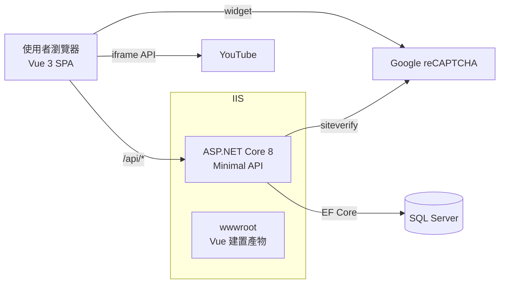
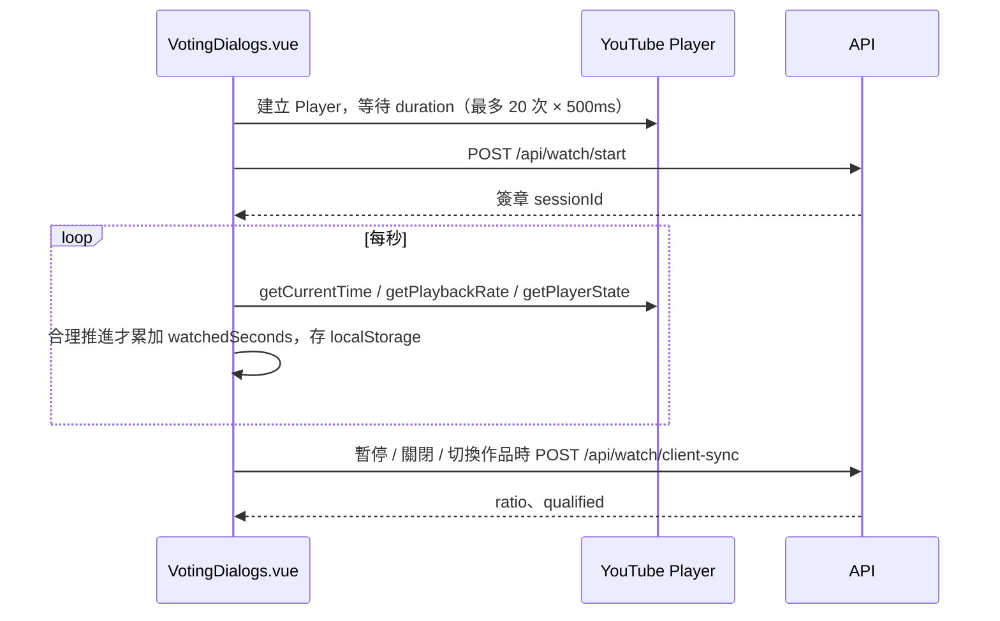

# GreenCare 專案分析報告

> 分析日期：2026-10-15
> 分析分支：`codex/client-progress-resilient-voting`（最新 commit `428a2ba`）
> 分析範圍：`src/`、`tests/`、`database/`、`.github/`、根目錄舊版 Node.js 程式與 `docs/` 既有文件

---

## 1. 專案概述

**「綠照好時光－短影音競賽網路人氣票選」** 活動網站。主辦單位為農業部農村發展及水土保持署，執行單位為台灣水資源與農業研究院。

| 項目 | 內容 |
|---|---|
| 型態 | 免登入、一頁式影片票選網站 + 獨立結果頁 |
| 作品來源 | YouTube 影片，作品目錄存於 SQL Server `Videos` 資料表 |
| 組別 | 個人組（`individual`）、團體組（`team`） |
| 投票規則 | 每組 2 票、同作品不可重複投票、需有效觀看達 80%、投票後不可取消或改投 |
| 防機器人 | Google reCAPTCHA（前端使用 `grecaptcha.enterprise`） |
| 活動期間（Production） | 2026-10-12 10:00 至 2026-10-23 17:00（Asia/Taipei） |
| 部署目標 | Windows IIS（正式）、GitHub Pages（Mock 展示版） |

---

## 2. 技術棧

| 層級 | 技術 | 版本 / 備註 |
|---|---|---|
| 前端 | Vue 3 + TypeScript + Vite | Vue 3.5、Vite 8、vue-tsc；無路由函式庫、無狀態管理函式庫 |
| 前端測試 | Vitest + @vue/test-utils + jsdom | 5 個 spec 檔，約 23 個測試 |
| 後端 | ASP.NET Core 8 Minimal API | `net8.0`，僅相依 `Microsoft.EntityFrameworkCore.SqlServer 8.0.20` |
| 資料存取 | EF Core 8 + 原生 SQL 鎖定提示 | **禁止** EF Migrations / `EnsureCreated()`，Schema 由人工 SQL 腳本管理 |
| 資料庫 | SQL Server（開發用 LocalDB `GreenCare_Development`） | |
| 後端測試 | xUnit | 14 個測試檔，約 39 個測試（含 SQL Server 整合測試） |
| CI/CD | GitHub Actions（僅手動觸發） | `deploy-pages.yml` 部署 Mock 展示版 |
| 舊版（遷移基準） | Node.js + Express 5 + better-sqlite3 | 位於根目錄，已不在發布流程內，預計第 14 步移除 |

---

## 3. 目錄結構

```
greencare/
├─ src/
│  ├─ GreenCare.Api/            # ASP.NET Core 8 API（同時託管 Vue 靜態檔）
│  │  ├─ Data/                  # DbContext、Entities、Fluent 設定
│  │  ├─ Features/              # 依功能切分：Devices / Videos / Watching / Voting / Results
│  │  ├─ Infrastructure/        # 安全、Cookie、HMAC、限流、Middleware、活動期間
│  │  └─ appsettings*.json      # Development / Testing / Production 設定
│  └─ greencare-web/            # Vue 3 前端
│     ├─ src/App.vue            # 首頁（作品列表、規則、即時排行）
│     ├─ src/VotingDialogs.vue  # 觀看 Dialog、進度追蹤、reCAPTCHA、投票確認
│     ├─ src/ResultsPage.vue    # 完整結果頁
│     ├─ src/demoApi.ts         # GitHub Pages 用的瀏覽器端 Mock API
│     └─ public/mock-videos.json
├─ tests/GreenCare.Api.Tests/   # xUnit 單元 + 整合測試
├─ database/
│  ├─ scripts/                  # 001~005 正向 Schema 腳本（人工依序執行）
│  ├─ rollback/                 # 對應回滾腳本
│  ├─ verify/                   # 001~008 驗證腳本
│  ├─ catalog/                  # 作品目錄資料（影片、YouTube ID、參賽者遮罩）
│  ├─ production/               # 正式庫建立、備份、清除測試資料
│  ├─ reports/                  # 匯出報表 SQL（票數、明細、風險稽核）
│  └─ templates/                # 新增應用程式帳號範本
├─ deploy/web.config.production.template
├─ docs/                        # 需求、遷移、部署、測試、操作手冊
├─ .github/workflows/deploy-pages.yml
└─ server.js / db.js / public/ / test/   # 舊版 Node.js（遷移基準，待移除）
```

---

## 4. 系統架構



- **單一部署單元**：`dotnet publish` 時會透過 `BuildFrontend` target 執行 `npm ci && npm run build`，把 Vue 產物放進 `wwwroot`，由 API 以 `UseStaticFiles` + `MapFallbackToFile("index.html")` 提供。
- **開發模式**：Vite（`:5173`）將 `/api` proxy 至 API（`:5080`）。
- **展示模式**：`VITE_DEMO_MODE=true` 時 `api()` 改呼叫 `demoApi.ts`，資料存於 `localStorage`，不連線任何後端。

### 4.1 Middleware 管線（`Program.cs`）

1. `UseForwardedHeaders`（只信任 `KnownProxies`，預設 loopback）
2. `ApiExceptionMiddleware`（統一錯誤格式）
3. `SecurityHeadersMiddleware`（CSP、`X-Frame-Options: DENY`、`nosniff` 等）
4. `UseHsts`（僅 Production）
5. `UseRateLimiter`（依 IP 的 HMAC 分區固定視窗）
6. 靜態檔 + SPA fallback

---

## 5. API 一覽

| 方法 | 路徑 | 用途 | IP 限流（每分鐘） | 其他限制 |
|---|---|---|---|---|
| GET | `/api/health` | 健康檢查與活動狀態 | 600 | |
| GET | `/api/bootstrap` | 作品目錄、本裝置票數與觀看進度、剩餘票數、reCAPTCHA Site Key | 600 | 讀取 `X-Device-Signal` |
| POST | `/api/watch/start` | 建立／續用觀看 Session，回傳簽章 Session Token | 120 | 每裝置 12 次/分 |
| POST | `/api/watch/progress` | 伺服器端心跳式進度計算 | 600 | 每裝置 60、每 Session 20 次/分 |
| POST | `/api/watch/client-sync` | 同步瀏覽器端累積的觀看進度 | 600 | |
| POST | `/api/votes` | 投票（含 reCAPTCHA 驗證） | 30 | 每裝置 10 次/分 |
| DELETE | `/api/votes/{id}` | 取消投票 | 30 | 受 `Voting:AllowCancellation` 控制，目前為 `false` |
| GET | `/api/results` | 兩組排名與票數 | 600 | 記憶體快取 5 秒 |

---

## 6. 資料模型

| 資料表 | 用途 | 重點 |
|---|---|---|
| `SchemaVersions` | 人工套用 SQL 版本紀錄 | |
| `Videos` | 作品目錄 | `Category`、`IsActive`、`SortOrder` 決定顯示，不可由 `Id` 推導組別 |
| `Devices` | 匿名裝置 | 對應 `vote_device` Cookie 中的 GUID |
| `WatchSessions` | 觀看進度 | `WatchedSeconds`、`LastPositionSeconds`、`QualifiedAtUtc` |
| `Votes` | 投票 | 狀態 `valid / flagged / cancelled / void`；存 `IpHash`、`DeviceSignalHash`、`RiskScore` |
| `RiskEvents` | 風險事件 | `vote_risk`、`device_cookie_invalid` |
| `AuditLogs` | 稽核 | `create_vote`、`cancel_vote` |

**隱私設計**：IP 與裝置訊號只儲存 HMAC-SHA256（32 bytes），不存原始值；HMAC 金鑰為 `Security:AppSecret`。

**權限設計**：應用程式帳號只屬於 `GreenCareAppRole`，可 CRUD 業務表、唯讀 `Videos` / `SchemaVersions`，被拒絕變更 `dbo` schema。

---

## 7. 核心業務流程

### 7.1 裝置識別

- `DeviceCookieService` 發放 `vote_device` Cookie（HttpOnly、SameSite=Lax、一年；Production 加 Secure），內容為 Data Protection 簽章的 GUID。
- Cookie 被竄改時重新發放並寫入 `device_cookie_invalid` 風險事件。
- `DeviceIdentityService` 以靜態 `ConcurrentDictionary` 節流，同一裝置 5 分鐘內只更新一次 `LastSeenAtUtc`。

### 7.2 觀看進度（雙軌）



- **前端判斷規則**（`pollProgress`）：頁面可見、播放中、倍速 `0 < rate ≤ 1.25`、位移 `0 ≤ Δ ≤ elapsed × 1.6 + 1` 才累加，避免快轉、背景播放、異常倍速。
- **伺服器端規則**（`WatchProgressEvaluator`）：與前端相同的合理性檢查，另有 3 秒節流與「回到開頭」重播偵測。
- 目前分支主要走 **client-sync 路徑**：進度保存在 `localStorage` (`greencare-client-watch-v1`) 與記憶體，網路中斷也不會遺失。

### 7.3 投票（`VotingEndpoints.CreateAsync`）

1. 活動期間檢查 → `DeviceSignal` 格式檢查 → 裝置層限流 → reCAPTCHA 驗證
2. 計算風險分數：`(10 分鐘內同 IP 票數 − 20) × 4 + 同裝置訊號的其他裝置數 × 25`，夾在 0–100
3. 開啟 **Serializable** 交易，並以 `UPDLOCK, HOLDLOCK` 鎖定：
   - 該裝置的 `Devices` 列
   - 同 `IpHash + DeviceSignalHash` 在該組的有效票（跨瀏覽器防重）
   - 同 `DeviceId` 在該組的有效票
4. `VoteLimitValidator`：同作品不可重複、每組最多 2 票
5. 觀看資格：若請求帶 `WatchProgress` 就以其寫入／驗證 ≥ 80%；否則查詢已合格的 `WatchSession`
6. 寫入 `Votes`、（必要時）`RiskEvents`、`AuditLogs`，提交後使結果快取失效

### 7.4 結果

- 只計 `valid` 票（`flagged` 不計入），依票數遞減、`Id` 遞增排名。
- 活動結束後 `published = true`、`live = false`。
- 首頁每 30 秒重新整理排行。

---

## 8. 安全機制摘要

| 面向 | 實作 |
|---|---|
| 密鑰管理 | `Security__AppSecret`（≥ 32 字元）、Data Protection 金鑰目錄（Windows Production 以 DPAPI 保護）；缺漏時拒絕啟動 |
| 防機器人 | reCAPTCHA，後端驗證 `success` 與 `hostname`；Production 缺 key 拒絕啟動 |
| 限流 | ASP.NET Core RateLimiter（IP）+ 自製 `RequestWindowLimiter`（裝置／Session） |
| 傳輸 | HSTS、Secure Cookie、Forwarded Headers 只信任白名單代理 |
| 瀏覽器防護 | CSP 白名單（YouTube、Google、gstatic）、`X-Frame-Options: DENY` 防止被嵌入 |
| 請求大小 | Kestrel / IIS 皆限制 20 KB |
| 併發一致性 | Serializable 交易 + 鎖定提示 + filtered unique index |
| 個資最小化 | IP、裝置訊號僅存 HMAC |

---

## 9. 測試現況

| 範圍 | 檔案 | 測試數（約） | 涵蓋重點 |
|---|---|---|---|
| 後端單元 | Voting / Watching / Results / Infrastructure | 34 | 票數限制、風險分數、進度判定、快取、Cookie 簽章、Forwarded Headers、Middleware |
| 後端整合 | `GreenCareDbContextIntegrationTests` | 5 | 需 SQL Server（`GREENCARE_TEST_SQLSERVER`） |
| 前端 | `VotingDialogs.spec.ts` 等 | 23 | Dialog 行為、進度、Mock API、作品編號 |
| 舊版 | `test/*.js` | 少量 | 遷移基準 |

**缺口**：`VotingEndpoints`、`PublicApiEndpoints` 沒有以 `WebApplicationFactory` 做的端到端 API 測試，交易鎖定與跨瀏覽器防重主要依賴人工驗收清單。

---

## 10. 風險與改善建議

依影響程度排序。

### 🔴 高

1. **觀看 80% 門檻可由用戶端偽造**
   `/api/watch/client-sync` 與 `/api/votes` 的 `WatchProgress` 直接採信瀏覽器回報的 `watchedSeconds`，`ClientWatchProgressWriter` 只檢查數值範圍，不檢查時間合理性。直接呼叫 API 送出 `watchedSeconds = duration` 即可跳過觀看。
   - 這是本分支為了「網路不穩也能投票」所做的取捨，伺服器端的 `WatchProgressEvaluator` 因此形同備援。
   - **建議**：至少驗證 `WatchSession.CreatedAtUtc` 到投票時間的實際經過秒數 ≥ `watchedSeconds × 0.8`（或 `/1.25`），或要求必須先有 `/api/watch/start` 建立的 Session；並將不符者標為 `flagged` 而非直接拒絕，以兼顧體驗。

2. **reCAPTCHA 前後端版本可能不一致**
   前端使用 `grecaptcha.enterprise`，後端呼叫的是傳統 `recaptcha/api/siteverify`。Enterprise 金鑰是否能用傳統端點驗證，取決於金鑰在 Google Cloud 的設定。
   - **建議**：在正式環境以真實金鑰確認驗證成功，或改用 reCAPTCHA Enterprise `createAssessment` API，並一併檢查 `action` 與 `score`。

### 🟠 中

3. **風險分數不影響計票**：`VoteRiskCalculator.Status()` 永遠回傳 `valid`，`flagged` 狀態實際上不會產生。若要事後剔除可疑票，需仰賴 `database/reports/005_risk_and_audit.sql` 人工判讀。建議活動結束前與業主確認處理原則。
4. **共用網路的誤擋**：裝置訊號只有 `platform | language | 螢幕尺寸 | 時區`。同一辦公室（同出口 IP）、同型號電腦的不同使用者會被視為「同一環境」，整個辦公室每組只能投 2 票。建議在 FAQ／提示訊息說明，或評估放寬為「僅記錄風險、不阻擋」。
5. **狀態存在單一行程記憶體**：`RequestWindowLimiter`、`ResultsCache`、`DeviceIdentityService.LastTouches` 都是行程內記憶體。IIS 必須維持單一 Worker Process（不可開 Web Garden、不可多台負載平衡），且 App Pool 回收會重置限流計數。部署文件應明確註記。
6. **記憶體字典不會清理**：`LastTouches` 與 `RequestWindowLimiter._windows` 只增不減。活動期僅 11 天，影響有限，但建議加入定期清理或改用 `IMemoryCache`（設定過期時間）。

### 🟡 低

7. **README 內容過時**：仍描述 Cloudflare Turnstile、30 支影片、Node.js 本機啟動，與現行 Vue／.NET／reCAPTCHA 架構不符，容易誤導新成員。
8. **前端程式碼可讀性**：`App.vue`、`VotingDialogs.vue` 大量單行壓縮式寫法（單行數百字元），不利 Code Review 與維護。建議導入 Prettier / ESLint 並拆分 composable（例如 `useYouTubePlayer`、`useWatchProgress`、`useRecaptcha`）。
9. **活動時間寫在 `appsettings.json`**：若需延長活動需重新部署或改環境變數，建議在部署文件說明可用 `Activity__EndsAt` 覆寫。
10. **工作目錄雜物**：根目錄有未追蹤的 `api-preview*.log`、`web-preview*.log`、`outputs/`，建議加入 `.gitignore`。
11. **舊版 Node.js 程式**：`server.js`、`db.js`、`public/`、`test/`、`videos.json` 已不在發布流程中，建議活動結束、確認不需回退後依遷移計畫第 14 步移除。

---

## 11. 既有文件索引（`docs/`）

| 分類 | 文件 |
|---|---|
| 需求 | `業主需求確認與技術建議.md`、`確認清單.md` |
| 遷移 | `技術棧遷移計畫書.md`、`技術棧遷移執行步驟.md`、`現行系統遷移基準.md`、`遷移執行驗收追蹤.md`、`baseline/`（畫面截圖） |
| 部署 | `IIS部署文件.md`、`PRODUCTION_DATABASE_SETUP.md`、`PRODUCTION_WEB_CONFIG.md`、`測試與正式環境部署切換.md` |
| 機制說明 | `投票與防護機制說明.md`、`網站提示訊息說明.docx` |
| 測試／驗收 | `本機測試Checklist.md`、`Client端觀看進度與首次投票驗收清單.md`、`Client端進度與投票Alert清單.md` |
| 問題排除 | `iPhone-Safari-reCAPTCHA無法勾選-修正說明.md`、`reCAPTCHA-dialog-AI開發避坑指南.md` |
| 營運 | `票選資料匯出與Excel交付操作手冊.md` |

---

## 12. 快速上手

```powershell
# 1. 依序執行 database/scripts/001~005（人工，對 LocalDB GreenCare_Development）
# 2. 啟動 API
dotnet run --project src/GreenCare.Api/GreenCare.Api.csproj --launch-profile http
# 3. 啟動前端
cd src/greencare-web; npm ci; npm run dev     # http://localhost:5173
# 4. 測試
dotnet test GreenCare.sln
cd src/greencare-web; npm test
# 5. 正式發布
dotnet publish src/GreenCare.Api/GreenCare.Api.csproj -c Release -o artifacts/publish/GreenCare.Api
```

開發環境未設定 reCAPTCHA Secret 時，前端送出 token `development-pass` 即可通過驗證（Production 不適用）。
